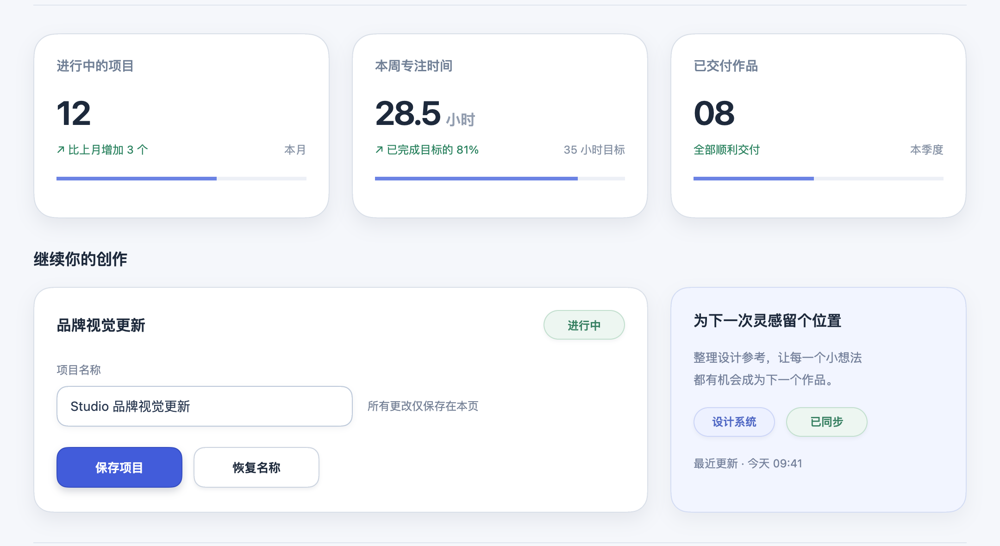
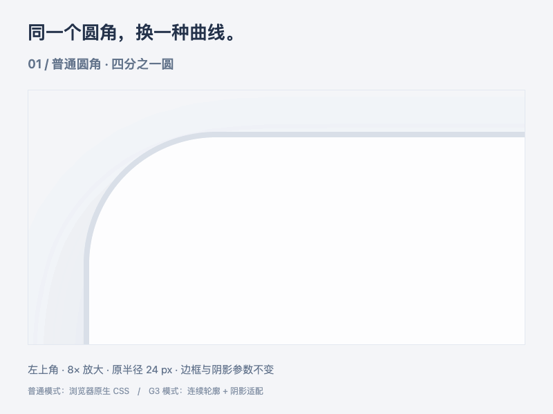

<div align="center">

# Apple Corners

**简体中文** · [English](README.en.md)

### 苹果风格圆角，保留你原来的设计。

一个轻量的 **Codex Skill**，用 G3 连续曲线替换现有圆角。<br>
从一张卡片，到整个网站：保留尺寸、半径参数、内容和布局。

**G3 连续几何** · **零第三方运行依赖** · **按需阴影适配**

[快速安装](#快速安装) · [使用方式](#使用方式) · [支持范围](#支持范围) · [实现说明](references/implementation.md)

</div>



<p align="center"><sub>真实页面迁移示例：原生 CSS 圆角 → G3 轮廓与阴影适配。圆角变化通常细微，不靠改版制造差异。</sub></p>

## 看看角部的区别



<p align="center"><sub>每 1.8 秒切换一次。相同的 24 px 半径、尺寸、边框和阴影参数；普通模式使用浏览器原生 CSS，G3 模式使用本 skill 的连续轮廓与阴影适配。为便于观察，仅展示角部绘制层，G3 填充与描边按放大倍率重新栅格化。</sub></p>

## 它做什么

把已有组件的圆角换成苹果风格的连续轮廓，同时尽量保留原有视觉效果。

- **只改圆角** — 不重排版，不改文案，不替换卡片设计。
- **沿用现有参数** — 保留尺寸、半径声明、设计 token 和响应式规则。
- **处理特殊形状** — 支持胶囊、大圆角、百分比、椭圆和不对称角。
- **批量迁移** — 从共用组件和主题入口入手，一次请求处理全站圆角。
- **按需适配阴影** — 保留原生阴影底层，通过差量补偿让阴影随 G3 轮廓变化。

> **先保证 G3，再贴近 Apple 观感。** 这是自定义的 Apple-inspired 几何，不是 Apple 原生算法。

## 快速安装

在终端执行：

```bash
git clone https://github.com/Followhongyun/apple-corners.git ~/.codex/skills/apple-corners
```

如果该目录已存在，先备份再替换；如果已经通过 Git 安装，可在目录内使用 `git pull --ff-only` 更新。

## 使用方式

安装后，在 Codex 中提及 `$apple-corners` 并说明要修改的对象。

**改一个组件**

```text
用 $apple-corners 把这个卡片改成苹果风格 G3 圆角。
保持现有宽高、半径、边框、阴影和内容不变。
```

**替换整个项目**

```text
用 $apple-corners 把整个网站的圆角替换成苹果风格 G3。
只调整圆角，保留现有设计与参数，检查按钮、输入框和胶囊标签。
```

**迁移已有 CSS 页面**

```text
用 $apple-corners 迁移这个已经使用 border-radius、border 和 box-shadow 的页面。
让阴影也跟随 G3，并用原生 CSS 截图对比验证其他设计没有变化。
```

## 支持范围

| 场景 | 处理方式 |
| :--- | :--- |
| 普通圆角 | 七次曲线，实现与直线的 G3 连接 |
| 大圆角、紧凑空间 | 自适应曲线剖面，保留输入参数 |
| 横向 / 纵向胶囊 | 完整八次端帽，避免中部多余拼接 |
| 百分比、椭圆、不对称角 | 按实际宽高及各角使用值计算 |
| 圆形、完整椭圆 | 保留本来的解析光滑轮廓 |
| 零半径角 | 保持尖角，不擅自圆化 |
| CSS 外阴影 | 可选差量适配；当前验证覆盖 Chromium 单层实色、无 spread/inset 的外阴影 |

## 实现与验证

不依赖第三方运行包。核心提供几何、RGBA 栅格化和浏览器 Canvas 遮罩；原生应用可接入图像遮罩或移植求值逻辑。

```bash
# 几何与阴影算法测试
node scripts/test-g3.mjs
node scripts/test-shadow-delta.mjs

# 导出 280 × 210、半径 40、2× 精度的 PNG 遮罩及几何 JSON
node scripts/export-g3.mjs 280 210 40 2 corner.png
```

| 文件 | 用途 |
| :--- | :--- |
| [SKILL.md](SKILL.md) | Codex 使用入口 |
| [实现说明](references/implementation.md) | API、特殊形状与连续性 |
| [阴影适配](references/shadows.md) | 原生 CSS 阴影的差量补偿与验收 |
| [圆角核心](scripts/g3-corners.mjs) | 几何与栅格化 |
| [阴影核心](scripts/shadow-delta.mjs) | 阴影补偿计算 |

## 使用边界

G3 指背后的连续几何，栅格图片本身有有限精度；含尖角的整个轮廓不声明 G3。边框、阴影和框架接入仍须在目标项目验证，部分阴影合成可能存在微小像素差异。

“全站替换”是一套由 Codex 执行的项目迁移流程，不是注入一条 CSS 就能无损覆盖任意网站的运行时库。原生平台与其他浏览器需另行验证。
